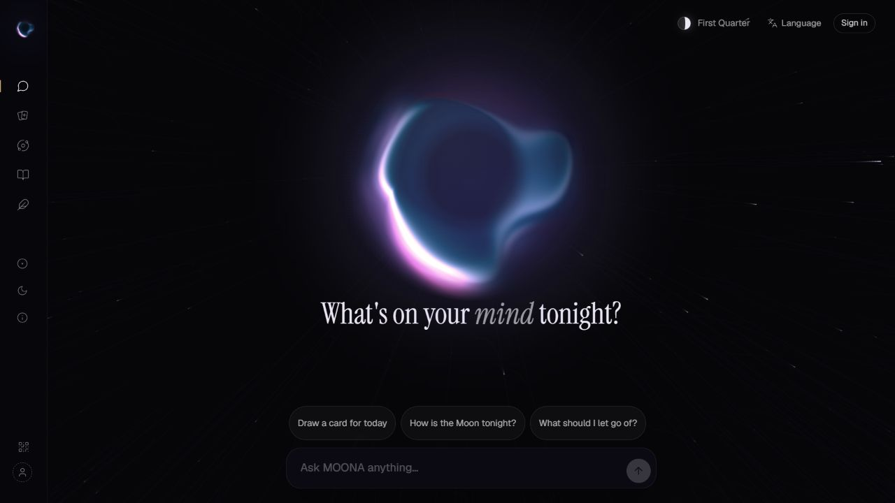
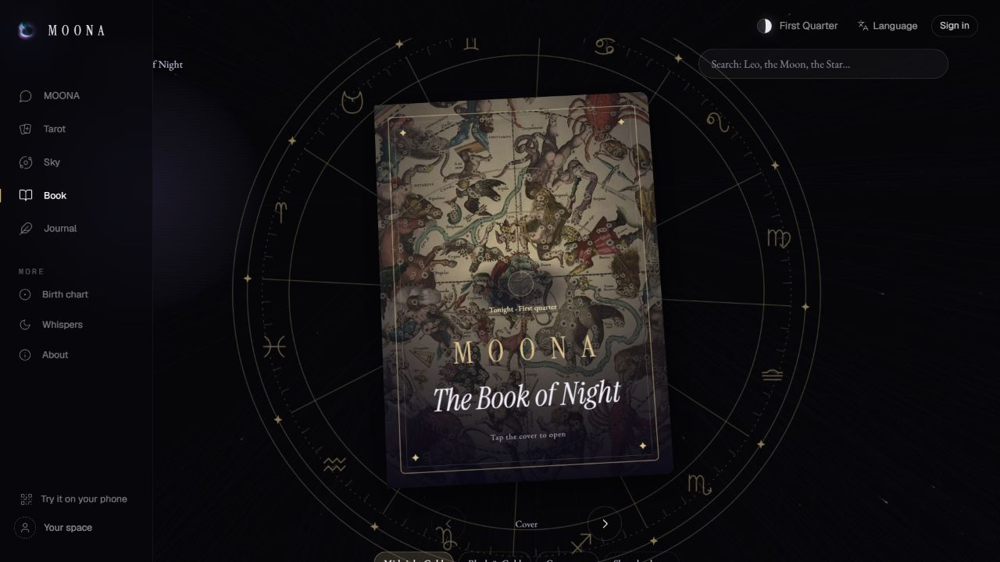
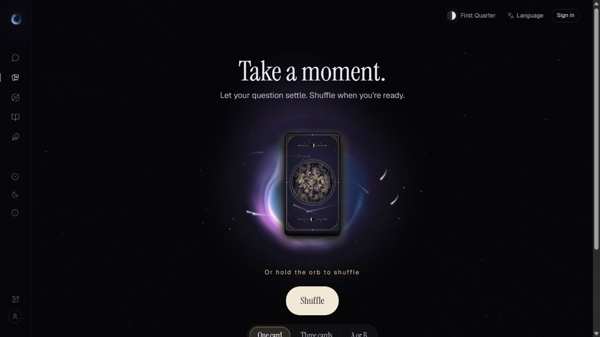
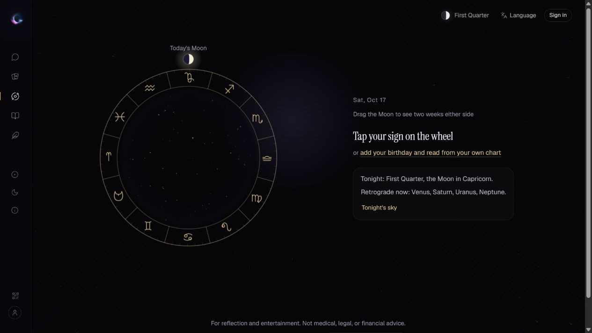

# MOONA

**给自己留一点时间。**

[在线体验](https://moona.fun/) · [打开星夜之书](https://moona.fun/learn) · [English](README.md) · [给我们写信](mailto:hello@moona.fun)

从一张塔罗牌、一幅星盘，到一次对话，MOONA 邀请你觉察情绪、梳理思绪，探索当下的自己。打开网页就能开始，支持桌面与手机、中英文切换。

## 现在可以体验什么

| 功能 | 体验 |
| --- | --- |
| [塔罗](https://moona.fun/tarot/new) | 自己洗牌、选牌，体验一张、三张或填写真实选项的二选一牌阵；读完后继续聊这组牌。 |
| [星夜之书](https://moona.fun/learn) | 可翻阅、搜索、收藏的双语知识书，包含星座、行星、宫位、相位、塔罗与牌阵，并与个人星盘关联。 |
| [今日星空](https://moona.fun/today) | 看计算得到的月相和天象，在星座轮盘上探索附近日期；可从太阳星座开始，也可结合出生星盘。 |
| [出生星盘](https://moona.fun/chart) | 探索太阳、月亮、上升，以及行星落点、宫位和相位；出生时间未知时会明确处理。 |
| [与 MOONA 对话](https://moona.fun/talk) | 聊聊此刻的问题，自行决定是否带入星盘落点、今日天象和保存过的笔记。 |
| [手记](https://moona.fun/me) | 回看当前设备上的解读、对话和亲自确认的笔记，支持导出或清除本地记录。 |

## 星夜之书

一本可以慢慢逛的夜间知识书：章节书签、双语内容、搜索收藏，以及不同视觉版本。

## 自己参与的抽牌仪式

问题可以先放在心里。准备好了再洗牌，亲自选出每一张牌，逐步展开解读。动态光球、牌面与星空陪伴这个过程，也可以减弱或关闭装饰动效。

## 计算与解读，各自说清楚

天体位置和月相由程序计算，AI 负责解读文字。产品区分实时 AI、已保存的 AI 回复、计算结果和离线内容，让你知道当前看到的内容来自哪里。

## 怎样开始

1. 打开 [moona.fun](https://moona.fun/)，无需安装 App。
2. 浏览星夜之书、看看天空，或先抽一张牌。
3. 当前提供有限的访客 AI 试用；出现提示后可用邮箱验证码登录，在 Demo 额度内继续体验，不设置密码。

Demo 仍在迭代，AI 可能出错，服务受使用额度限制。塔罗与星盘仅用于自我觉察和娱乐，不构成医疗、法律或财务建议。

## 数据说明

完整对话、手记、解读历史和出生资料保存在使用它们的浏览器里，**邮箱登录不会自动跨设备同步**。使用 AI 时，请求所需内容会经过服务器发给模型提供方；服务器会暂存回复，回复可能引用你说过的话。

邮箱账户、登录会话和使用计数保存在服务器，相关编号可能关联到账户，并非完全匿名。接收产品更新需要单独主动勾选。分享个人信息前，请阅读[当前隐私说明](https://moona.fun/about#sent-title)。

## 欢迎一起打磨 MOONA

使用中的小发现、希望遇见的新功能，或想对我们说的话，都欢迎写给我们：**[hello@moona.fun](mailto:hello@moona.fun)**。

也可以在 [Issues](https://github.com/KimChen001/moona-showcase/issues) 留下产品反馈；请不要公开验证码、邮箱地址、出生资料或私人对话。喜欢这个项目的话，欢迎点一颗 Star，让更多人发现 MOONA。

本仓库是公开产品展示，包含介绍和界面截图；应用源码与运行数据独立维护。截图于 2026 年 10 月 17 日从不含个人历史的会话截取，不代表所有功能已经完成最终验收。见[素材来源说明](ATTRIBUTION.md)。
