

  <strong>MOONA Desk Companion</strong> 
  <em>A small MOONA that waits on your desk.</em>

  <a href="README.md">Back to MOONA</a> ·
  <a href="desk-companion.zh-CN.md">中文介绍</a>

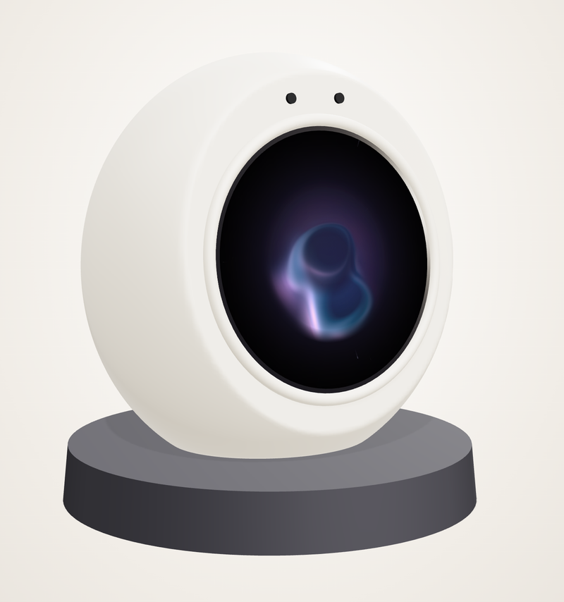

MOONA lives on the web today. The desk companion gives it a body: a palm-sized orb in soft, milk-white silicone, with a 1.75-inch round AMOLED screen for a face. It wakes when you speak to it, answers out loud, and charges when you set it on its magnetic dock.

**Status: in design.** The pictures on this page are a concept model and screen designs, not photos of a finished device.

## What the round face shows

<table>
  <tr>
    <td align="center">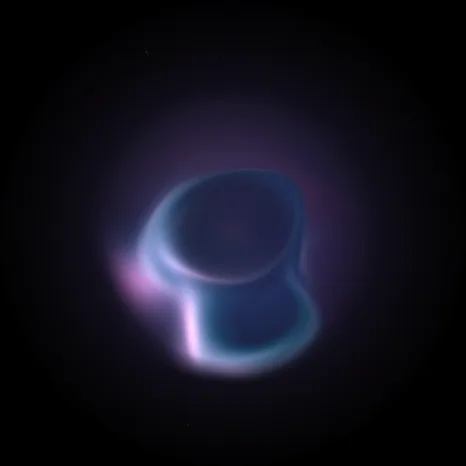 <b>Idle</b> the orb breathes slowly</td>
    <td align="center">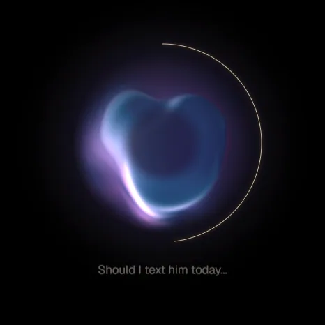 <b>Listening</b> a gold ring draws as you speak</td>
    <td align="center">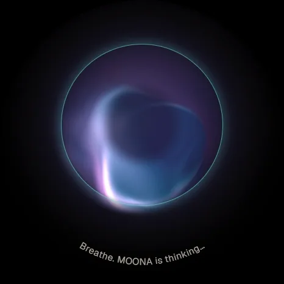 <b>Thinking</b> MOONA takes a breath</td>
    <td align="center">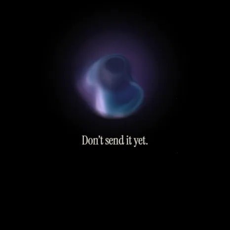 <b>Answering</b> short lines, spoken aloud</td>
    <td align="center">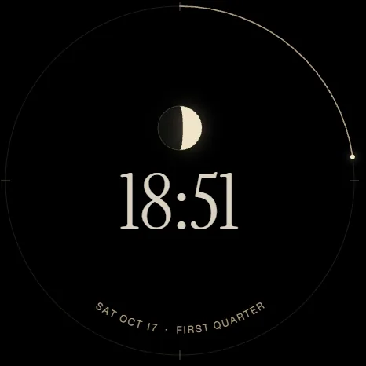 <b>Asleep</b> the time and tonight&#8217;s Moon</td>
  </tr>
  <tr>
    <td align="center">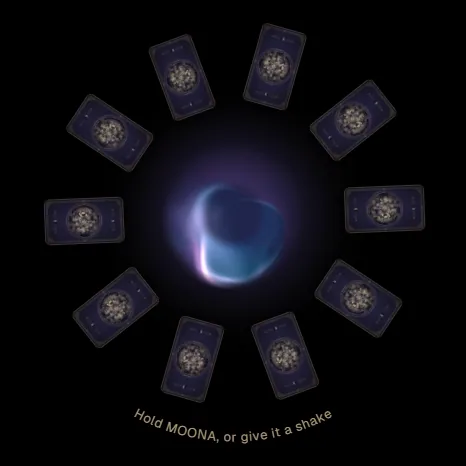 <b>Tarot shuffle</b> hold it, or give it a shake</td>
    <td align="center">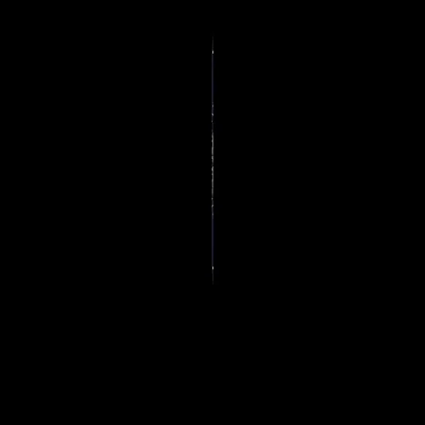 <b>Tarot reveal</b> the card turns over</td>
    <td align="center">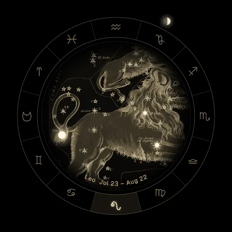 <b>Tonight&#8217;s sky</b> the zodiac rides the rim</td>
    <td align="center">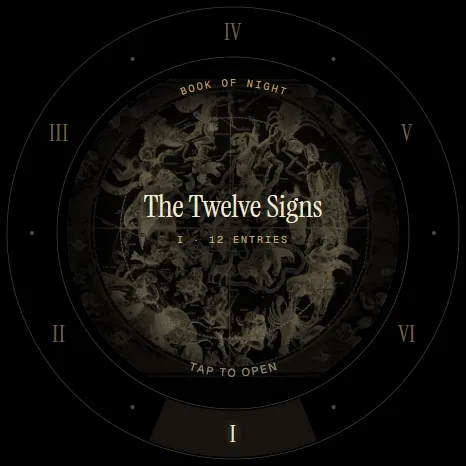 <b>Book of Night</b> turn the rim to pick a chapter</td>
    <td align="center">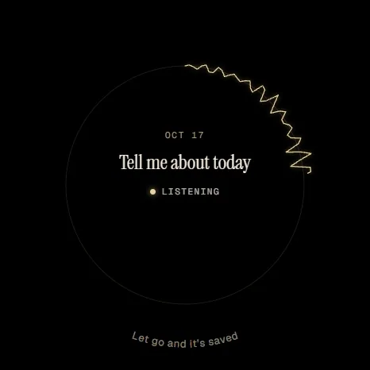 <b>Journal</b> say how today went</td>
  </tr>
</table>

Every screen is designed for a circle: short labels follow the curve, progress runs around the rim, and MOONA reads longer text aloud instead of filling the glass.

## How it is built

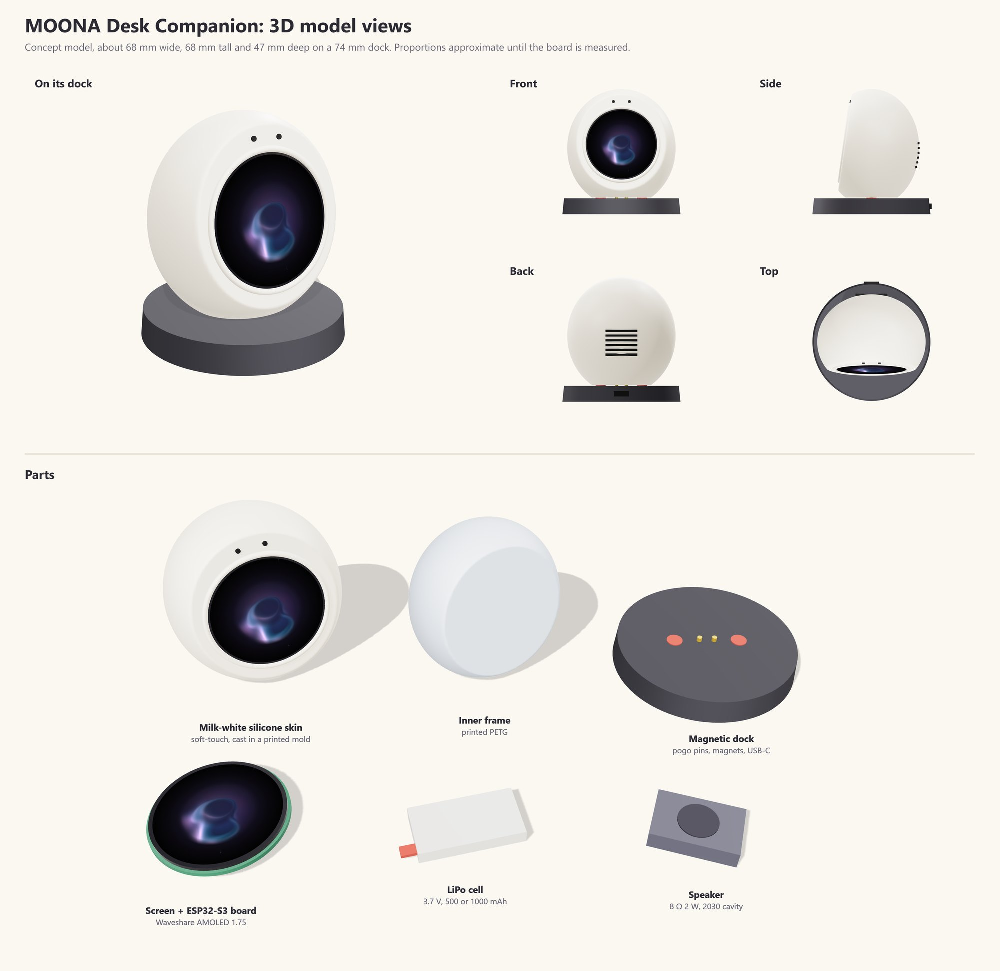

- **Face:** a Waveshare ESP32-S3-Touch-AMOLED-1.75 board: a 466 × 466 round touch AMOLED, two microphones with echo cancellation, and an audio codec.
- **Body:** a rigid printed inner frame inside a cast skin of soft, milk-white silicone.
- **Sound:** a small 8 Ω speaker behind a grille on the back.
- **Power:** a LiPo cell, charged through pogo pins on a magnetic dock with a USB-C input.

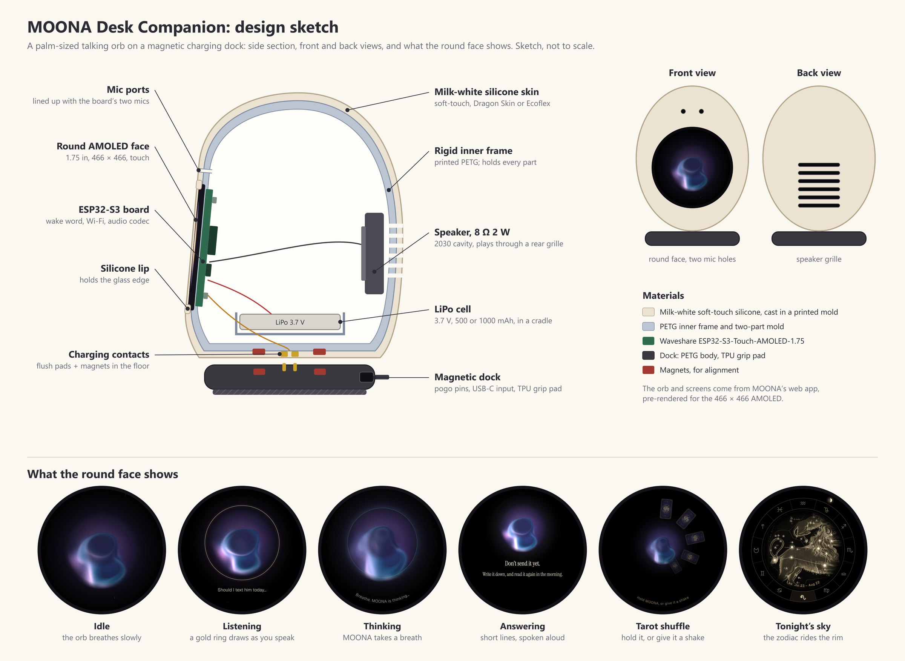

## Your voice

The wake word is detected on the device itself. Once it wakes, what you say goes to MOONA's server and a speech-recognition service to be transcribed and answered, as a typed conversation does on the web. The device and the web app are the same MOONA. See [Data and privacy](docs/data-and-privacy.md) for how the web demo handles your words today.

---

The orb on the screen adapts **Ether** by nimitz (CC BY-NC-SA 3.0); the tarot art is the 1909 Rider–Waite–Smith deck. See [Credits and rights](ATTRIBUTION.md).
